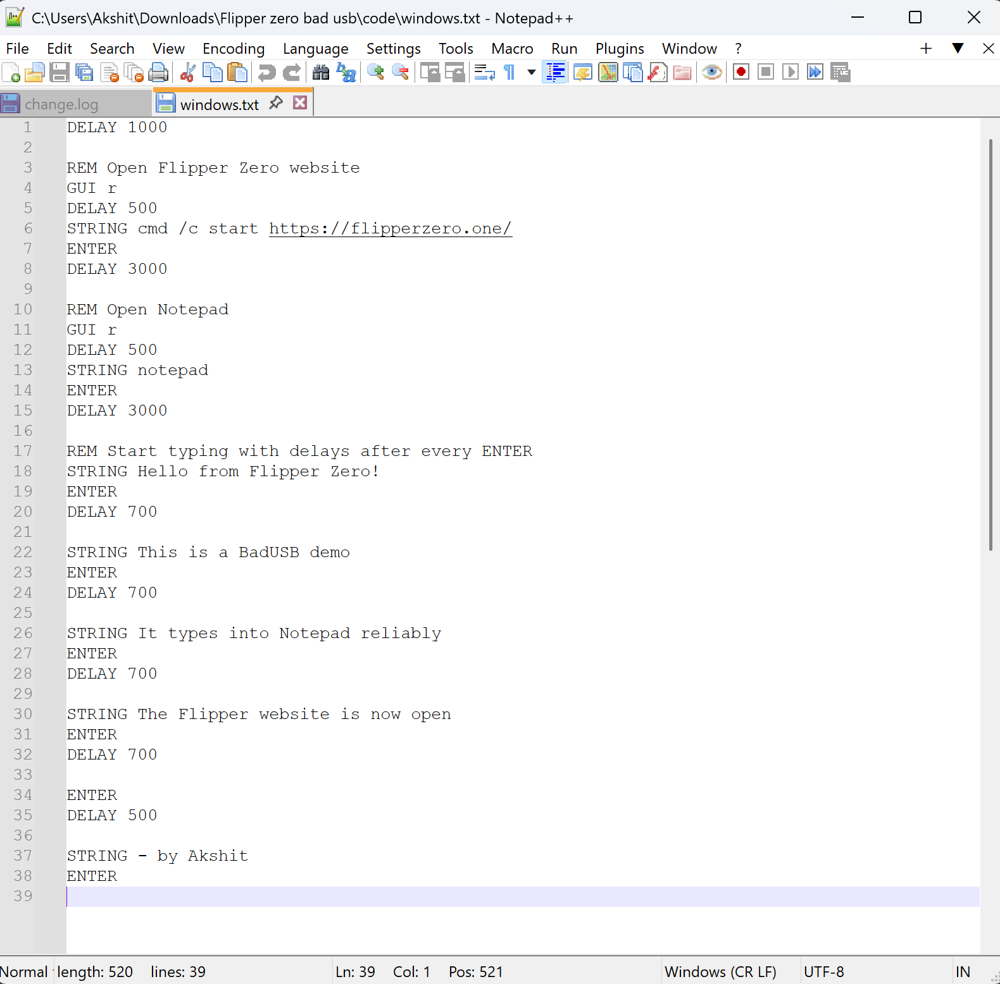
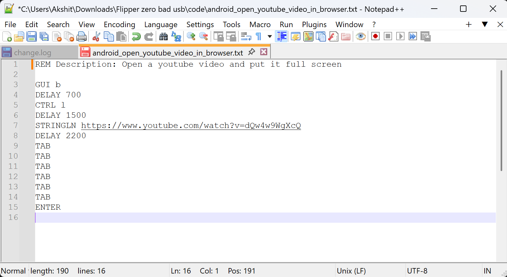
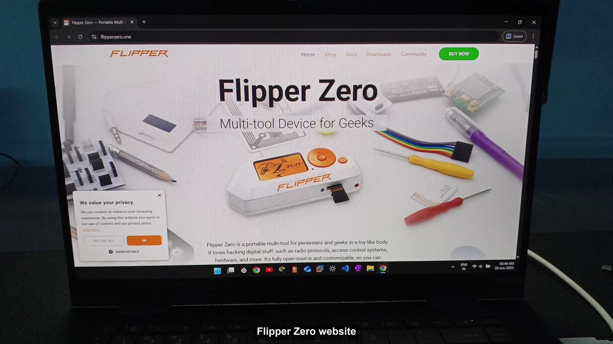
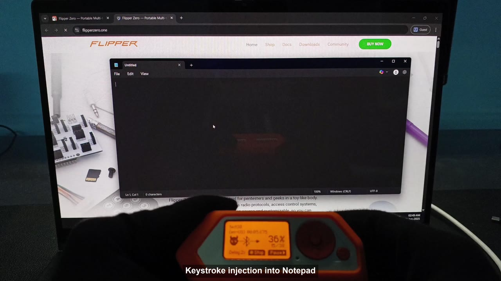
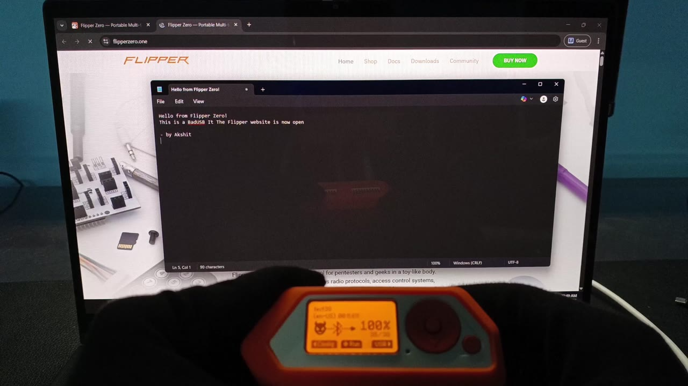

<div align="center">

# Flipper Zero — Wireless BadUSB over Bluetooth HID

**Cable-free keystroke injection against Windows 11 & Android 14 using the Flipper Zero's Bluetooth HID profile.**

[](#tested-environment)
[](https://flipperzero.one/)
[](#how-it-works)
[](#payloads)
[](LICENSE)
[](#-legal--ethical-disclaimer)

</div>

> A hands-on security research project demonstrating how a Flipper Zero, acting as a **wireless Bluetooth keyboard (HID)**, can inject keystrokes and execute scripted payloads on a victim device **without any USB cable or physical contact** — and how the Bluetooth HID trust model makes this stealthy and repeatable.

<video src="https://github.com/user-attachments/assets/06796a4f-eaf3-4bb2-af22-d217bdcd265e" width="100%" controls></video>
<br>

---

## ⚠️ Legal & Ethical Disclaimer

This project is published **strictly for education, security research, and authorized testing**.

- Everything here was performed in a **controlled environment on devices owned by the author**.
- Running keystroke-injection payloads against systems you **do not own or lack explicit written permission to test is illegal** in most jurisdictions (e.g. the Computer Fraud and Abuse Act, the UK Computer Misuse Act, and equivalents).
- The author and contributors accept **no liability** for misuse of the material in this repository.
- The payloads here are deliberately **benign** (they open a website and type text). They are designed to illustrate the attack *vector*, not to cause harm.

**Use it to learn and to defend. Do not use it to attack.**

---

## Table of Contents

- [Overview](#overview)
- [How It Works](#how-it-works)
- [Repository Structure](#repository-structure)
- [Payloads](#payloads)
- [Demo](#demo)
- [Tested Environment](#tested-environment)
- [Reproduction Guide](#reproduction-guide)
- [Key Findings](#key-findings)
- [Security Implications](#security-implications)
- [Defense & Mitigation](#defense--mitigation)
- [Tech Stack](#tech-stack)
- [Documentation](#documentation)
- [Author](#author)
- [License](#license)

---

## Overview

**BadUSB** attacks abuse the implicit trust operating systems place in Human Interface Devices (keyboards & mice). A device that *claims* to be a keyboard is trusted to type — instantly, with no driver prompt and no user confirmation.

Traditionally this requires a USB device (e.g. a Rubber Ducky) to be physically plugged in. This project removes the cable entirely: the **Flipper Zero emulates a Bluetooth keyboard**, pairs once with the target, and from then on can inject keystrokes **wirelessly and silently** on every reconnect.

To make the attack more realistic, the Flipper was **renamed to "Sony Headphones"** — a device name users instinctively trust — demonstrating how social engineering amplifies the Bluetooth HID weakness.

The project validates the technique on **two platforms**:

| Platform | Payload goal | Result |
|----------|--------------|--------|
| Windows 11 | Open Flipper website → launch Notepad → type a structured message | ✅ Reliable injection |
| Android 14 | Open browser → navigate to a URL → trigger playback | ✅ Reliable injection |

---

## How It Works

```
┌──────────────┐   1. Pair once (BT HID)    ┌─────────────────────┐
│ Flipper Zero │ ─────────────────────────► │  Target (Win/Android)│
│  "Sony       │                            │                     │
│  Headphones" │   2. Device auto-trusted   │  OS trusts the HID  │
│  (BT HID kbd)│ ◄───────────────────────── │  as a keyboard      │
│              │                            │                     │
│  Ducky       │   3. Inject keystrokes     │  Keystrokes execute │
│  Script      │ ─────────────────────────► │  as if locally typed│
│  payload     │   (no cable, no prompt)    │                     │
└──────────────┘                            └─────────────────────┘
```

1. **Emulate** — Flipper Zero advertises itself as a Bluetooth HID keyboard.
2. **Pair** — The target pairs once. No MFA/2FA is involved in HID pairing.
3. **Trust** — The OS remembers and auto-trusts the device for all future sessions.
4. **Inject** — A BadUSB-syntax (Ducky Script) payload is replayed as keystrokes, executing commands the moment focus is on the right window.

The payloads use **tuned `DELAY` instructions** to stay in sync with the target's UI (window focus, page loads, app launches). Reliable timing — not raw speed — is what makes Bluetooth HID injection work.

---

## Repository Structure

```
flipper-zero-bluetooth-badusb/
├── README.md                     # You are here
├── LICENSE                       # MIT
├── .gitattributes                # Preserves CRLF line endings for payloads
├── .gitignore
├── payloads/                     # Ducky Script / BadUSB payloads
│   ├── windows_notepad_demo.txt  # Windows 11 proof-of-concept
│   └── android_open_youtube.txt  # Android 14 proof-of-concept
├── docs/                         # Technical write-ups
│   ├── 01-setup-guide.md         # Flashing, firmware, pairing, deploying
│   ├── 02-methodology.md         # What was tested and how
│   ├── 03-ducky-script-reference.md  # Command cheat sheet
│   ├── 04-security-implications.md   # Why this matters
│   └── 05-defense-and-mitigation.md  # How to defend
└── assets/
    ├── images/                   # Payload source screenshots
    │   ├── windows-payload-script.png
    │   └── android-payload-script.png
    ├── screenshots/              # Stills captured from the live demo
    │   ├── demo-01-keystroke-injection.jpg
    │   ├── demo-02-payload-complete.jpg
    │   └── demo-03-flipper-website.jpg
    └── video/
        └── demo.mp4              # Full demo recording
```

---

## Payloads

### Windows 11 — Notepad Keystroke Injection
[`payloads/windows_notepad_demo.txt`](payloads/windows_notepad_demo.txt)

Opens the Flipper Zero website, launches Notepad, and types a structured multi-line message. A `DELAY` follows every `ENTER` so no characters are dropped.

<div align="center">
  
</div>

### Android 14 — Browser Navigation
[`payloads/android_open_youtube.txt`](payloads/android_open_youtube.txt)

Focuses the browser address bar, navigates to a URL, and uses `TAB` navigation to trigger playback — proving Bluetooth HID injection bypasses the USB restrictions many phones enforce.

<div align="center">
  
</div>

---

## Demo

**Full demo video (in repo):** [`assets/video/demo.mp4`](assets/video/demo.mp4)

<!--
  ▶️  SHORT DEMO VIDEO PLACEHOLDER
  Drag-and-drop your <10 MB demo clip (demo_attachment.mp4) directly into this
  README on github.com (edit mode). GitHub uploads it to its CDN and inserts a
  user-images URL right here. Replace this comment block with that embed.
-->

### Stills from the demo

| Flipper website opens | Keystroke injection | Payload complete |
|:---:|:---:|:---:|
|  |  |  |
| Browser launched over BT HID | Notepad receiving keystrokes (Flipper mid-payload) | Full message typed — payload at 100% |

---

## Tested Environment

| Component | Details |
|-----------|---------|
| Attack device | Flipper Zero (Bluetooth HID mode) |
| Spoofed name | "Sony Headphones" (trust-based social engineering) |
| Target OS 1 | Windows 11 |
| Target OS 2 | Android 14 |
| Payload syntax | BadUSB / Ducky Script (Bluetooth-compatible) |
| Encoding | ANSI, CRLF line endings (reliable typing) |
| Scripting tool | Notepad++ / VS Code |

---

## Reproduction Guide

> Full step-by-step instructions are in [`docs/01-setup-guide.md`](docs/01-setup-guide.md).

1. Install a firmware with Bluetooth HID / BadUSB support on the Flipper Zero.
2. (Optional) Rename the Flipper's Bluetooth name to a trusted-sounding device.
3. Copy a payload from [`payloads/`](payloads/) onto the Flipper's SD card (`badusb/` folder).
4. On the Flipper: **Apps → GPIO/Bad USB → Bluetooth**, then pair with the target.
5. Focus the correct window on the target and run the payload.

---

## Key Findings

- ✅ **Cable-free execution** — full keystroke injection with zero physical contact.
- ✅ **Cross-platform** — worked reliably on both Windows 11 and Android 14.
- ⚠️ **One-time pairing = long-term access** — once trusted, the Flipper re-injected on reconnect with **no prompt, alert, or re-authentication**.
- ⚠️ **No MFA on HID** — Bluetooth HID pairing is not protected by 2FA/MFA.
- ⚠️ **Trust is nameable** — a friendly device name ("Sony Headphones") dramatically lowers user suspicion.
- ⚠️ **Mobile exposure** — Bluetooth HID sidesteps USB-based restrictions on phones.

---

## Security Implications

> Detailed analysis in [`docs/04-security-implications.md`](docs/04-security-implications.md).

Bluetooth HID keystroke injection is a **stealthy, wireless** evolution of the classic BadUSB attack. There is no cable to spot, the malicious device can masquerade as everyday peripherals, and the implicit post-pairing trust means an attacker who gains trust **once** retains silent access. This is especially dangerous in **BYOD and open-plan office** environments where stray Bluetooth pairings go unnoticed.

---

## Defense & Mitigation

> Full checklist in [`docs/05-defense-and-mitigation.md`](docs/05-defense-and-mitigation.md).

- Disable Bluetooth when not in use; audit the list of paired devices regularly.
- Treat **unexpected pairing requests as hostile** — even from familiar-sounding names.
- Lock the workstation when unattended (injected keystrokes need an interactive session).
- Enforce endpoint controls / EDR that can flag anomalous HID behavior.
- On managed fleets, restrict or alert on new HID device enrollment.
- Apply the principle of least privilege so a typed command can do limited damage.

---

## Tech Stack

`Flipper Zero` · `Bluetooth HID` · `BadUSB / Ducky Script` · `Windows 11` · `Android 14` · `Wireless Attack Simulation` · `Red Teaming` · `Social Engineering` · `Notepad++ / VS Code`

---

## Documentation

| Doc | Contents |
|-----|----------|
| [01 — Setup Guide](docs/01-setup-guide.md) | Firmware, pairing, deploying payloads |
| [02 — Methodology](docs/02-methodology.md) | Exactly what was tested and how |
| [03 — Ducky Script Reference](docs/03-ducky-script-reference.md) | Command cheat sheet |
| [04 — Security Implications](docs/04-security-implications.md) | Why the attack matters |
| [05 — Defense & Mitigation](docs/05-defense-and-mitigation.md) | How to defend against it |

---

## License

Released under the [MIT License](LICENSE). The ethical-use terms in the [disclaimer](#-legal--ethical-disclaimer) apply to all use of this material.
